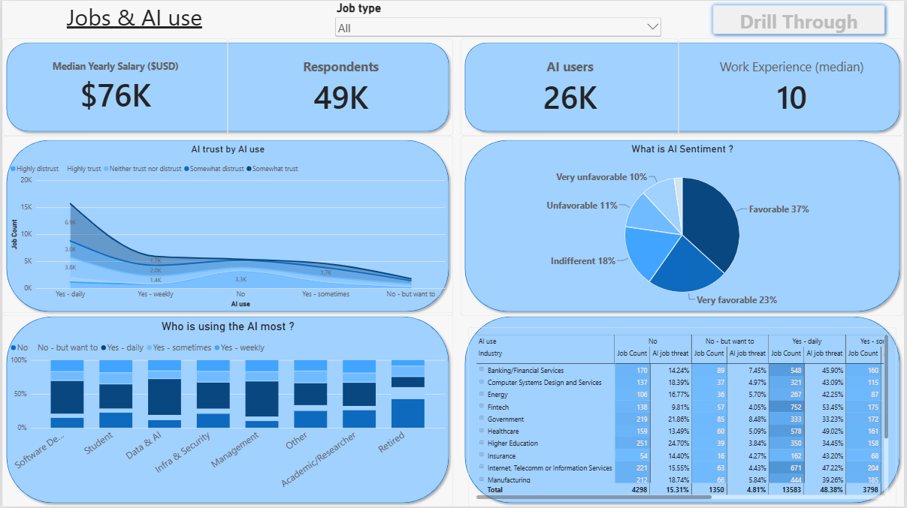
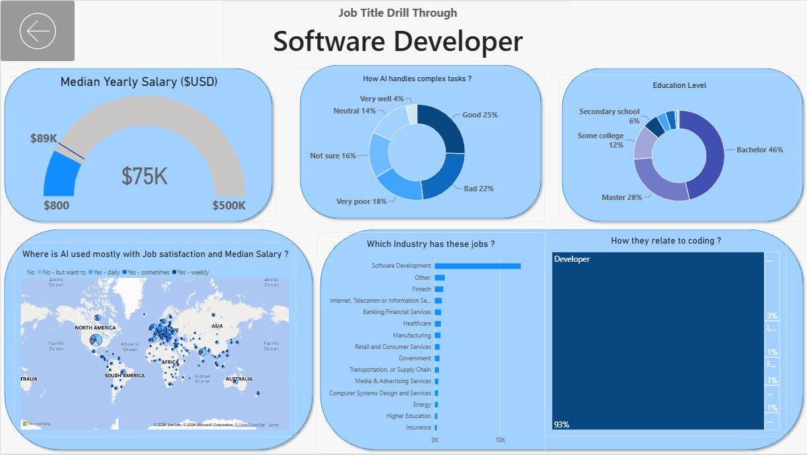

# What Developers Say About AI: Stack Overflow Survey 2025 (Power BI Dashboard)

## Introduction
This is a two-page Power BI dashboard built on the cleaned Stack Overflow Developer Survey 2025 (49,191 respondents). It looks at how developers use AI, how much they trust it, and how that relates to their jobs, industries and pay.

## Skills showcased
- **Power BI:** stacked column, area, pie, donut, gauge, map, treemap and matrix visuals
- **Interactivity:** slicer, buttons, drill-through from job type to a detail page
- **Measures and aggregations:** medians, counts and percentages (median used for salary and experience, since both are skewed)
- **Conditional formatting** and a consistent blue theme
- **Data storytelling:** a titled chart for each question, with the number of respondents kept in view
- **Data cleaning (Pandas):** clean columns that keep the raw values, so outliers did not distort the results

## Page 1: Jobs & AI use (overview)

- **Cards:** median yearly salary (about $76K), respondents (49K), AI users (26K) and median work experience (10 years)
- **AI sentiment (pie):** 60% feel favorable or very favorable about AI, and about 21% feel unfavorable or very unfavorable
- **AI trust by AI use (area chart):** how trust in AI accuracy is spread across daily, weekly, occasional and non-users
- **Who is using AI most (100% stacked column):** the AI-use mix inside each job type
- **Industry matrix:** respondents and job-threat views by industry and AI use, with colour scales
- **Job type slicer** filters the whole page, and the **Drill Through** button opens the detail page for one job type

## Page 2: Job title drill-through (example: Management)

- **Salary gauge:** the group's median pay ($116K) against the survey average ($133K)
- **How AI handles complex tasks (donut):** for Management, 30% say good, 23% bad, 14% very poor and 6% very well
- **Education level (donut):** Bachelor 39% and Master 34% are the largest groups
- **Map:** AI usage by country for that job type
- **Industries (bar chart):** where these jobs sit, led by Software Development
- **How they relate to coding (treemap):** 60% Developer, 17% Occasional coder, 12% Former developer

## Conclusion
- AI is mainstream in this survey: about 78% of those who answered use it at least sometimes, and about 47% use it daily.
- Most developers feel favorable about AI, but fewer trust it with complex tasks, and the "bad" and "very poor" answers outnumber "good" and "very well".
- Daily AI users report a lower median salary than non-users. This is a correlation, not a cause, because country and experience mix differ between the groups.
- The survey is voluntary and self-reported, so the results describe the respondents, not all developers.

**Data source:** Stack Overflow Developer Survey 2025 (ODbL). Cleaned dataset on [Kaggle](https://www.kaggle.com/datasets/aman03s/stack-overflow-survey-2025-ai).